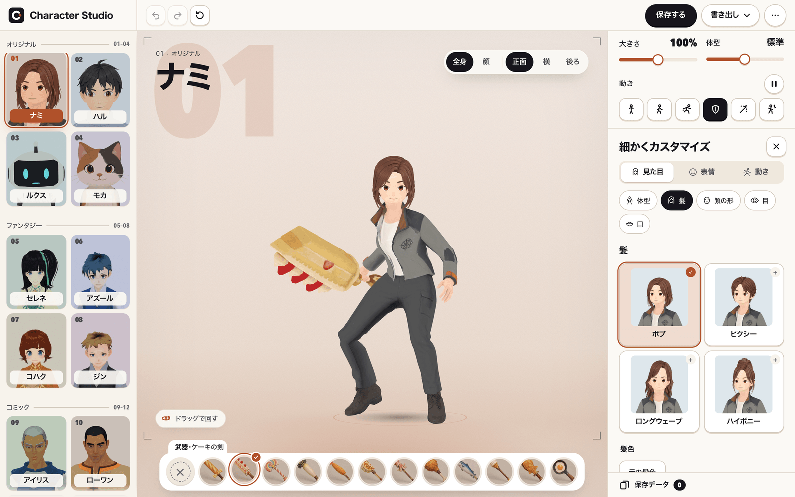
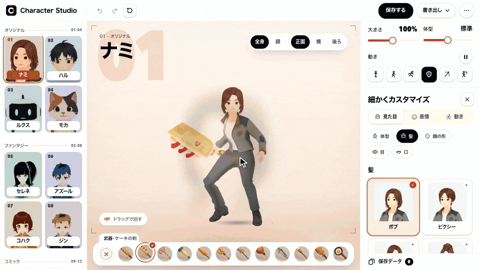
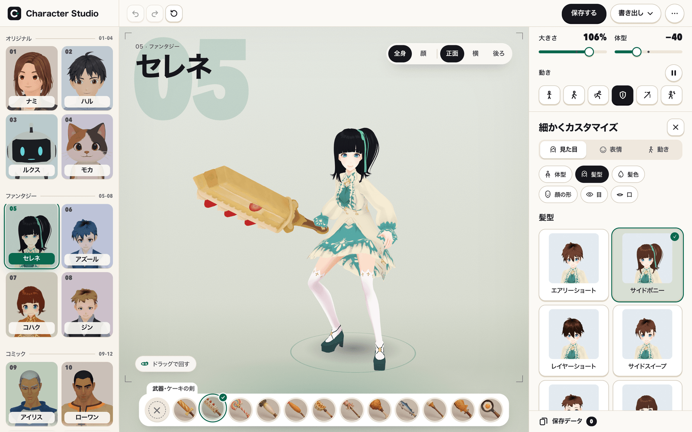
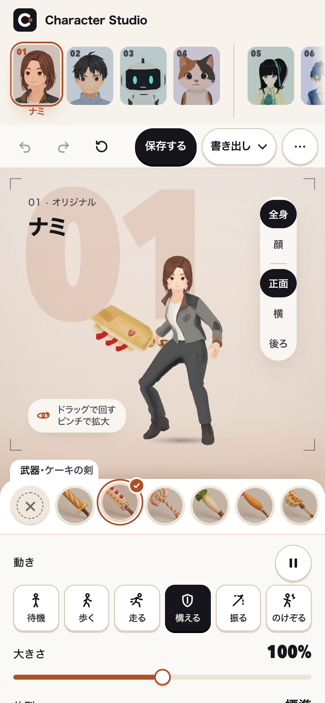
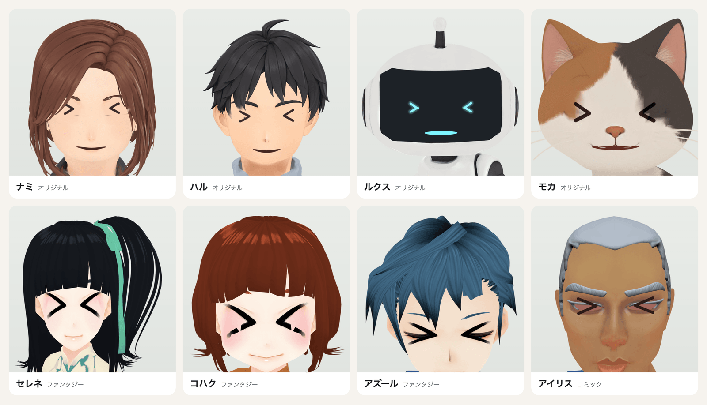
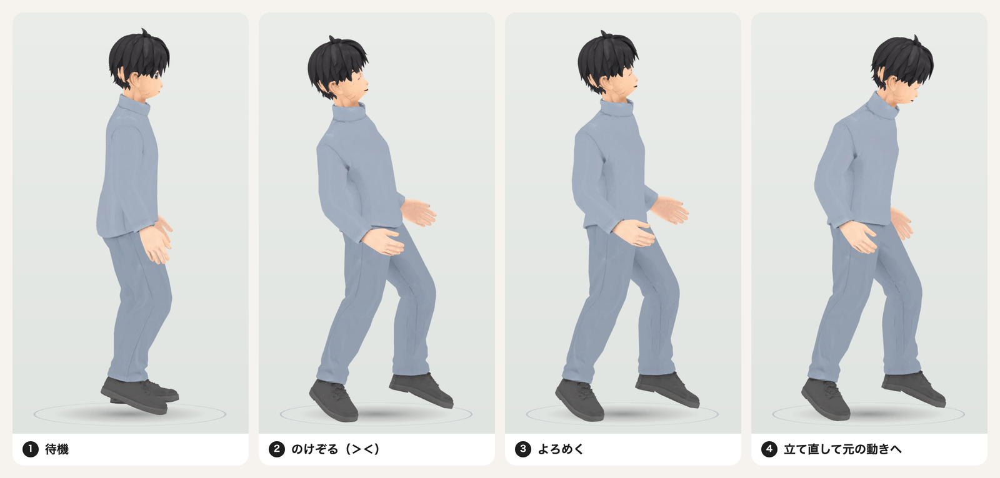
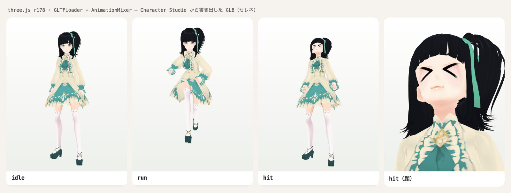

# Character Studio（character-maker）

**日本語** | [English](README.en.md)

ブラウザで 3D キャラクターを選んで、その場でカスタマイズし、ゲームでそのまま使える GLB に書き出すキャラクターメイクです。





[操作動画（MP4・32秒）](docs/media/demo.mp4)

- 16キャラ: オリジナル4体（ハル・ナミ・ルクス・モカ）＋ファンタジー8体＋アメコミ4体
- 体型・髪型・髪色・顔・目・口・表情・服の色・武器（食べ物の武器12種）を編集
- 動き: 待機・歩く・走る・武器を構える・武器を振る・**のけぞる（被弾）**、顔: **＞＜**
- 保存（ブラウザ）、JSON の書き出し・読み込み、GLB の書き出し
- Next.js 15 / React 19 / three.js / React Three Fiber。サーバーやアカウントは不要

## 画面 / Screens

| ファンタジーのセレネ | スマホ（390px） |
|---|---|
|  |  |

**＞＜ の顔**（上: オリジナル4体、下: プリセット）



**のけぞり**（被弾。①待機 ②のけぞる＋＞＜ ③よろめく ④立て直す）



**書き出した GLB を素の three.js で再生**（idle・run・hit・hit の顔）



## Quick start

Node.js 22 以上（推奨 24）と pnpm 11 を使います。Requires Node.js ≥ 22 and pnpm 11.

```sh
pnpm install --frozen-lockfile
pnpm assets:sync      # parts/ と distribution/ から public/ の実行時素材を作る（public/ のバイナリは git 管理外）
pnpm dev
```

http://127.0.0.1:4284/character-maker を開きます。開発サーバーは `127.0.0.1:4284` で待ち受けます（同じ LAN のスマホから開くときは `pnpm exec next dev --hostname 0.0.0.0 --port 4284`）。

| URL | 画面 |
|---|---|
| `/character-maker` | Character Studio（16キャラから選んでカスタマイズ） |
| `/character-maker/classic` | 旧キャラメイク画面（ゲームに埋め込む `CharacterMaker` コンポーネントの単体表示） |

## yukikau.jp で遊ぶ / Play on yukikau.jp

作ったキャラは、ゲーム [yukikau.jp](https://yukikau.jp/) でそのまま遊べます。

1. **ダウンロードして読み込む**: 「書き出し」→ **yukikau.jp 用（.character.zip）** を保存し、表示される「yukikau.jp で読み込む」（`https://yukikau.jp/play?import=1`）で、そのファイルを選びます。中身は yukikau.jp の持ち込み形式（`character.json`・`model.glb`・`thumbnail.png`）で、向き（+Z）・身長・待機／歩く／走る・のけぞり・＞＜ が入ります。
2. **yukikau.jp の中で作る**: yukikau.jp の入口の「キャラメイク」（`/play?make=1`）で、この Character Studio がそのまま開きます。**この姿で遊ぶ** を押すと、作ったキャラでゲームが始まります。

## ゲームで使う / Use in your game

画面右上の「書き出し」から **3Dモデル（GLB）** と **編集設定（JSON）** を保存できます。GLB は three.js・Babylon.js・Unity（glTFast）などでそのまま読めます。素材は光源を使わない unlit（`KHR_materials_unlit`）です。

### 入っているアニメーション / Animation clips

| クリップ名 | 内容 | 再生のしかた |
|---|---|---|
| `idle` / `walk` / `run` | 待機・歩く・走る（標準の書き出し）。オリジナル4体は `preset:biped:idle` のように接頭辞が付く | ループ |
| `sword_idle` / `sword_attack` | 武器を構える・振る（武器ありの書き出し） | 構えはループ、振るは一回再生のあと `sword_idle` へ |
| `hit` | のけぞり（被弾）。再生中は顔が ＞＜ になる | 一回再生（約0.66秒）のあと元の動きへ |
| `face_hurt` | ＞＜ の顔だけ（体は動かさない） | 他のクリップと同時にループ再生 |

＞＜ の顔を出すときは、`face_hurt` を今の動きと**重ねて**再生してください（`hit` には最初から入っています）。キャラの種類によって、顔の板（ノード `maker-hurt-face`）の scale かモーフの重みで出すため、ノードを手で表示するのではなくクリップを使います（名前の正本は `lib/character-maker/hurt.ts`、詳しくは [docs/main-character-spec.md](docs/main-character-spec.md)）。

### three.js の例

```js
import * as THREE from 'three';
import { GLTFLoader } from 'three/examples/jsm/loaders/GLTFLoader.js';

const gltf = await new GLTFLoader().loadAsync('/my-character.glb');
scene.add(gltf.scene);
const mixer = new THREE.AnimationMixer(gltf.scene);
// オリジナル4体の標準の書き出しは `preset:biped:idle` のように接頭辞が付くので、末尾の名前で探す
const clip = name => gltf.animations.find(c => c.name === name || c.name.endsWith(`:${name}`));

const idle = mixer.clipAction(clip('idle') ?? clip('sword_idle')).play();

// 攻撃を食らったとき: のけぞって ＞＜、終わったら元の動きへ
function onDamaged() {
  const hit = mixer.clipAction(clip('hit'));
  hit.reset().setLoop(THREE.LoopOnce, 1).play();
  idle.crossFadeTo(hit, 0.08, false);
  mixer.addEventListener('finished', function back(event) {
    if (event.action !== hit) return;
    mixer.removeEventListener('finished', back);
    hit.crossFadeTo(idle.reset().play(), 0.15, false);
  });
}

// ＞＜ の顔だけをしばらく出す（体の動きはそのまま）
function showHurtFace(seconds = 1) {
  const face = mixer.clipAction(clip('face_hurt')).reset().play();
  setTimeout(() => face.stop(), seconds * 1000);
}

// 毎フレーム
const clock = new THREE.Clock();
renderer.setAnimationLoop(() => { mixer.update(clock.getDelta()); renderer.render(scene, camera); });
```

### React コンポーネントとして埋め込む

Studio（16キャラ、のけぞり・＞＜つき）は `CharacterStudio` として、ほかの Next.js アプリへ埋め込めます。`onPlay` を渡すと各エディタに「この姿で遊ぶ」が出て、yukikau.jp 用の `.character.zip` の `File` を受け取れます。Studio は画面いっぱい（`100dvh`）で、このリポジトリの `globals.css` やレイアウトは要りません（置き場所は埋め込み先が決めます）。

```tsx
// next.config: transpilePackages: ['@aiarranger/character-maker']
import CharacterStudio from '@aiarranger/character-maker/CharacterStudio';

<CharacterStudio onPlay={async file => startGame(file)} />
```

props は `onPlay?: (file: File) => void | Promise<void>`・`initialName?: string`（プリセットの最初の名前）・`className?: string` です。

旧画面の `CharacterMaker`（`components/character-maker/CharacterMaker.tsx`）もそのまま使えます。`onPlay` には書き出した GLB の `File` が渡ります。

```tsx
<CharacterMaker originals={[]} initialName="勇者" onPlay={async file => startGame(await file.arrayBuffer())} />
```

部品の配信は `@aiarranger/character-maker/server` を使います。取り込み用の tgz は `pnpm pack:vendor` で作れます（`tools/pack.mjs`、50 MiB 未満）。

- `serveMakerAsset(req, res)`: `/maker-assets/…`・`/character-maker/…`・`/portraits/…`・`/review-swing-2026-10-02/…`・`/api/character-maker/assets/…`・`/models/…` を届けます（開発サーバー用）。それ以外のパス（取り込み先自身の `/models/…` など）は取り込み先に任せます。
- `await ensureStudioModels(cacheDir)`: オリジナル4体の表示用モデル（`/models/`、約97MB）は tgz に入りません。公開リポジトリの固定コミットから取り、SHA-256 を確かめて `cacheDir` に置きます（足りないもの・違うものだけ）。一覧はパッケージの `studio-models.json` です。まだ取っていないモデルは、`serveMakerAsset` が頼まれたときにも取ります。
- `copyMakerAssets(outRoot)`: 静的書き出し用。部品と、`ensureStudioModels` で用意したモデルを `outRoot` へ写します。

```js
import { ensureStudioModels, serveMakerAsset, copyMakerAssets } from '@aiarranger/character-maker/server';
await ensureStudioModels('.cache/character-maker-models');
// 開発サーバー: if (serveMakerAsset(req, res)) return;
// 静的書き出し: copyMakerAssets('out');
```

## フォルダ / Layout

| パス | 内容 |
|---|---|
| `app/character-maker/` | 画面（Studio と classic） |
| `components/character-maker/`・`lib/character-maker/` | 編集・3D 表示・保存・書き出し |
| `parts/` | 共通部品（CC0 原本と、そこから組み立てた体・髪・動作）。詳細は [parts/README.md](parts/README.md) |
| `distribution/` | オリジナル4体のモデルと動作（CC BY 4.0）。一覧と SHA-256 は `distribution/manifest.json` |
| `public/review-swing-2026-10-02/` | 食べ物の武器（CC BY 4.0） |
| `tools/character-maker/` | 部品の組み立て・サムネイル撮影・書き出し確認・受入計測 |
| `docs/` | 画面の設計（[studio-quality-spec.md](docs/studio-quality-spec.md)）、メインキャラ対応（[main-character-spec.md](docs/main-character-spec.md)）、yukikau.jp への経路（[yukikau-route.md](docs/yukikau-route.md)） |

## 確認 / Checks

```sh
pnpm typecheck
pnpm test
pnpm assets:check
node tools/character-maker/measure-studio.mjs /tmp/measure     # 画面幅ごとの受入計測（pnpm dev を起動した状態で）
```

画面の E2E（`lib/character-maker/*.e2e.mjs`）は開発サーバーを起動した状態で `node --import ./tests/ts-resolve.mjs lib/character-maker/<名前>.e2e.mjs <出力先>` で実行します。Playwright は npx のキャッシュから探し、Google Chrome（headless）で動かします（`tools/lib/paths.mjs`）。確認先は `CHARACTER_MAKER_URL`（既定 `http://127.0.0.1:4284`）。

## 既知の課題 / Known issues

- 「振る」の頂点の数フレームで、剣先が 3D 表示の端に触れることがある
- ケーキの剣が板のように見える、ナミの襟がにじむ、アメコミ4体の顔のテクスチャが濁る、待機がほとんど動かないキャラがいる（モデル側の課題）
- オリジナルの表示用モデルが大きい（ナミ約25MB）。初回の読み込みに時間がかかる

## License

- Code: [MIT](LICENSE)
- Assets: CC BY 4.0（AI Arranger のオリジナル4体・武器）と CC0 1.0（Quaternius・VRoid β の原本と派生物）。パスごとの条件は [LICENSE-ASSETS.md](LICENSE-ASSETS.md)、出典は [NOTICE.md](NOTICE.md)
- Attribution for CC BY assets: "Character Studio assets by AI Arranger (CC BY 4.0)"

## Credits

Quaternius（Universal Base Characters / Modular Character Outfits - Fantasy / Universal Animation Library, CC0）、VRoid Project（VRoid β CC0 samples）。Made by AI Arranger.
